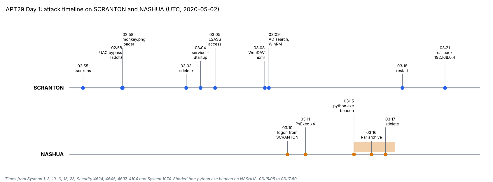

# APT29 Day 1: Windows Event Log Investigation

> **Status: complete as a case write-up.** Five phases, a full timeline with MITRE ATT&CK mapping, and a cross-check with rule-based detection. See [Scope](#scope-of-this-write-up) for how each part was produced.

A hands-on investigation of a multi-host attack simulation, using only Windows event logs (Sysmon, Security and PowerShell).

## Goal

Reconstruct what an attacker did across four Windows machines in about 33 minutes, starting from one suspicious file, using only log evidence. The core technique is tracing the execution tree (`ProcessGuid` → `ParentProcessGuid`) and recording only what the logs prove.

## Lab setup and tools

| Item | Detail |
|---|---|
| Lab | Windows 10 VM set up for DFIR work (Defender disabled so artifacts are generated, snapshots for clean states) |
| Analysis | Eric Zimmerman's Timeline Explorer (main tool) |
| Decoding | CyberChef for Base64 and gzip |
| Detection cross-check | Hayabusa (Sigma rules) |
| Reference | MITRE ATT&CK, Sysmon documentation |
| Study aid | An AI assistant, used to understand concepts faster and learn them better |

## Dataset

- **Source:** the APT29 evaluation (day 1, manual run) from the [OTRF Security-Datasets](https://github.com/OTRF/Security-Datasets) project, which comes from the MITRE ATT&CK Evaluations emulation.
- **Size:** about 196,000 rows and 388 columns after converting the JSON export to CSV.
- **Hosts:** `SCRANTON`, `NASHUA`, `NEWYORK`, `UTICA`. **Time window:** 2020-05-02, about 02:55 to 03:28 UTC.
- **The data is not included in this repo.** Download it from the source above.

Most rows are noise for a first pass. Registry (Sysmon 12, 13) and process-access (Sysmon 10) events make up more than half of them, while process creation (Sysmon 1) is only 447 rows. So I filter first to the event types a question needs, so Timeline Explorer stays fast: EventID 1 (process creation, 447 rows) and EventID 3 (network connections, 1,229 rows) are the two main views.

## Method

1. Scope the data: hosts, time range, event types.
2. Find an **anchor**: the earliest process that doesn't belong.
3. Walk down the tree using `ParentProcessGuid` = the process's `ProcessGuid`.
4. Pivot sideways on the same `ProcessGuid` into network, file and registry events.
5. Write each finding as: `time | host | process | what it did | proof (ProcessGuid)`.
6. Separate **proven** (in the logs) from **inferred** (a reasonable guess).

## Progress

| Phase | Topic | Notes |
|---|---|---|
| 1 | [Initial access](investigation/phase-1-initial-access.md) | Hands-on |
| 2 | [Execution, UAC bypass and the `monkey.png` payload](investigation/phase-2-execution-and-tools.md) | Hands-on, closed with the payload analysis |
| 3 | [Command and control](investigation/phase-3-command-and-control.md) | Four channels across two hosts |
| 4 | [Persistence and cleanup](investigation/phase-4-persistence-and-cleanup.md) | Service, Startup file, registry payload, `sdelete`, reboot |
| 5 | [Credentials and lateral movement](investigation/phase-5-credentials-and-lateral-movement.md) | LSASS, collection scripts, exfiltration, PsExec to NASHUA |
| All | [Timeline and ATT&CK map](investigation/timeline-and-attack-map.md) | One table, with evidence and what the logs cannot show |
| Check | [Cross-check with Sigma-based detection](investigation/detection-rules-cross-check.md) | Hayabusa compared with the manual timeline |
| Method | [Working method](approach.md) | How I narrow a large dataset and verify findings |

## Scope of this write-up

- **Phases 1 and 2** were worked hands-on in Timeline Explorer, one question at a time.
- **Phases 3 to 5, the timeline and the cross-check** are written as reproducible findings: each section names the filter (host, EventID, time window, `ProcessGuid`) that returns the rows, so any claim can be re-checked on the original CSV in Timeline Explorer.
- Statements the logs do not prove are labelled **inferred** or **not proven**. The timeline ends with a list of what the logs do not show.
- This case is closed. My ongoing practice moves to raw `.evtx` collections and new attack chains (see [the method page](approach.md)).

## What happened, in short



On **SCRANTON**, user `DMEVALS\pbeesly` double-clicked a screensaver file disguised as a document (`<RTLO>cod.3aka3.scr`). It opened a command shell for the attacker, who bypassed UAC through `sdclt.exe` and ran a loader hidden in the pixels of `monkey.png`. The attacker then installed persistence (a service named after Java, a Startup shortcut and a registry-stored payload), tried to dump LSASS, collected private keys, screenshots, clipboard and keystrokes, sent the Downloads folder out over WebDAV, searched Active Directory, and moved to **NASHUA** with PsExec. There the attacker archived data with a password and wiped files. Both hosts were cleaned with `sdelete`. After a restart, the persistence brought the callback back.

Techniques are mapped to MITRE ATT&CK in the [timeline](investigation/timeline-and-attack-map.md): user execution, right-to-left override masquerading, UAC bypass, steganography, in-memory shellcode, service and Startup persistence, LSASS access, keylogging, screen and clipboard capture, WebDAV exfiltration, PsExec lateral movement and secure deletion.

## Dataset quirks (worth knowing before you start)

- **Mixed-case channel names.** `Channel` contains both `Security` and `security`. Filtering on one silently drops about half the Security rows.
- **Two clocks.** Sysmon rows have `UtcTime`. Security and other rows only have `EventTime`, which is local time (UTC-4). My script adds 4 hours so there is one `Time_UTC` column.
- **Garbled filename character.** The right-to-left override (U+202E) appears as `‮` after conversion. The scripts show it as `<RTLO>`.
- **Windows reuses PIDs.** Always build trees from `ProcessGuid`, not `ProcessId`.

## Repo layout

```
APT29-Day1-Investigation/
├── README.md                      this file
├── approach.md                    working method and checks
├── resources.md                   datasets, lab setup, tools, reference docs
├── concepts.md                    key concepts in plain language
├── investigation/
│   ├── phase-1-initial-access.md
│   ├── phase-2-execution-and-tools.md
│   ├── phase-3-command-and-control.md
│   ├── phase-4-persistence-and-cleanup.md
│   ├── phase-5-credentials-and-lateral-movement.md
│   ├── timeline-and-attack-map.md
│   └── detection-rules-cross-check.md
└── images/                        evidence images for each phase
```

## Credits

- **Dataset:** [OTRF Security-Datasets](https://github.com/OTRF/Security-Datasets), built on the [MITRE ATT&CK Evaluations](https://attackevals.mitre-engenuity.org/) APT29 emulation.
- **Tools:** [Timeline Explorer and EvtxECmd](https://ericzimmerman.github.io/) by Eric Zimmerman, [CyberChef](https://gchq.github.io/CyberChef/) by GCHQ, and [Hayabusa](https://github.com/Yamato-Security/hayabusa) with its Sigma-based rules by Yamato Security.
- **Practice logs:** [EVTX-ATTACK-SAMPLES](https://github.com/sbousseaden/EVTX-ATTACK-SAMPLES) by Samir Bousseaden.
