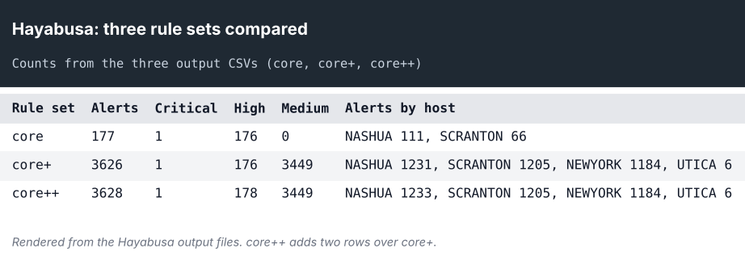
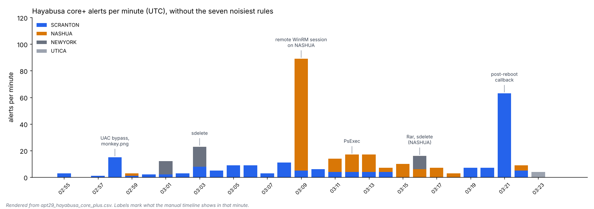
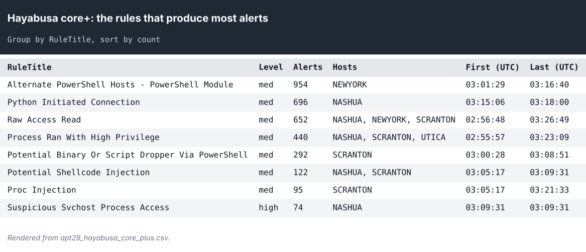
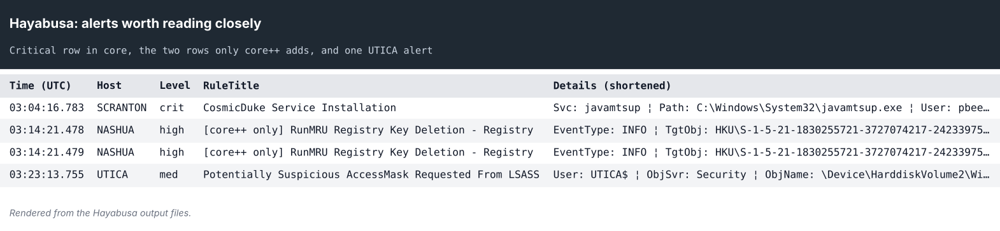

# Cross-check with Sigma-based detection (Hayabusa)

After the manual investigation I ran [Hayabusa](https://github.com/Yamato-Security/hayabusa) over the same dataset (JSON input) to see how a rule-based timeline compares with a hand-built one. Times were set to UTC to match my notes. The rules are Sigma rules and Hayabusa's own.

## Rule sets compared

| Rule set | Alerts | What it adds |
|---|---|---|
| `core` | 177 (176 high, 1 critical) | High and critical rules only |
| `core+` | 3,626 | Medium-level rules as well (3,449 medium alerts) |
| `core++` | 3,628 | Two more rows than `core+` (see below) |

Alerts by host (`core+`): NASHUA 1,231, SCRANTON 1,205, NEWYORK 1,184, UTICA 6. In `core`, only SCRANTON (66) and NASHUA (111) have alerts.

## What the rules caught (matches my manual findings)

| Attack step | Rule (examples) |
|---|---|
| `.scr` launched | "Proc Exec (Non-Exe Filetype)", "Potential CommandLine Obfuscation Using Unicode Characters" (the right-to-left override) |
| UAC bypass | "Bypass UAC Using DelegateExecute", "Removal of Potential COM Hijacking Registry Keys" |
| Hidden PowerShell and shellcode | Base64 and obfuscation rules, "Potential Shellcode Injection", "Proc Injection" |
| Collection scripts | "Certificate Exported Via PowerShell", "Windows Screen Capture with CopyFromScreen", "PowerShell Get Clipboard", "Powershell Keylogging" |
| Exfiltration over WebDAV | "WebDav Client Execution Via Rundll32.EXE", "Suspicious New-PSDrive to Admin Share" |
| Remote execution | "Execute Invoke-command on Remote Host", "Potential PsExec Remote Execution", "PSExec Lateral Movement" |
| Service persistence | "CosmicDuke Service Installation" (the only critical alert) |
| Startup file | "Potential Startup Shortcut Persistence Via PowerShell.EXE" |
| Cleanup | "Potential File Overwrite Via Sysinternals SDelete", "File Deleted Via Sysinternals SDelete", "Rar Usage with Password and Compression Level" |
| After reboot | The 03:21 minute has 63 non-noise alerts, one of the densest minutes in the data |

## Noise: what the volume is made of

Most alerts come from a handful of medium rules:

| Rule | Alerts | Where |
|---|---|---|
| Alternate PowerShell Hosts - PowerShell Module | 954 | NEWYORK only (03:01 to 03:16): PowerShell module loading, no link to the attack chain |
| Python Initiated Connection | 696 | NASHUA only (03:15 to 03:18): the `python.exe` implant beaconing to `192.168.0.4:8443` (348 connections in the Sysmon 3 rows). Real activity, but repetitive, so one alert is enough to investigate |
| Raw Access Read | 652 | all hosts |
| Process Ran With High Privilege | 440 | SCRANTON and NASHUA, mostly 4673 events |
| Potential Binary Or Script Dropper Via PowerShell | 292 | SCRANTON (03:00 to 03:08) |

In `core`, the most frequent rule is "Suspicious Svchost Process Access" (74 alerts).

## Notes on specific alerts

- **"CosmicDuke Service Installation"** fires on the `javamtsup` service (03:04:16). The rule matches a known naming and path pattern for a malware family's persistence. It proves the pattern matched, not that the malware is CosmicDuke. The evidence in the logs is the service itself, who installed it (`pbeesly`, from an interactive session) and what it ran.
- **UTICA has 6 alerts** (03:22 to 03:23): `WmiPrvSE.exe` and `sppsvc.exe` privilege use, an LSASS access by `CollectGuestLogs.exe`, and a SYSTEM `cmd.exe` spawned by `CollectGuestLogs.exe`. These belong to the cloud VM's guest agent, not to the attacker. The low count is a sign that UTICA was not part of the attack path.
- **`core++` adds two rows** over `core+`: "RunMRU Registry Key Deletion - Registry" (high, T1070.003) on NASHUA at 03:14:21, written by `Explorer.EXE`. `RunMRU` stores the history of the Run dialog. A deletion by Explorer itself can be routine or can be cleanup. The logs alone do not decide it, so I note it as a lead.

## Where the rules were silent

| Activity | Why it matters |
|---|---|
| LDAP search of Active Directory (`10.0.0.4:389`, `Ad-Search`) | Discovery with built-in tools has no rule in this set |
| The pixel-reading of `monkey.png` | The wrapper command line is only caught by its parts (obfuscation, encoded command) |
| The PowerShell module downloads at 03:08 | Destinations look like ordinary web traffic |
| The `192.168.0.4` destination across hosts | Rules fire per event, so they do not link the NASHUA beacon, the WebDAV copy and the SCRANTON callbacks to one server. A pivot on the destination address does |

## What I take from it

1. A rule-based timeline is a **map of where to look**. It found the same attack stages I found by hand, but with 3,626 rows at medium level, the critical and high rows are the ones to read first.
2. The rules cannot say *why* an event matters. That comes from the process tree and the script blocks.
3. Every alert should be checked against the original event. A rule title is a hypothesis.
4. Gaps in coverage are findings too: they show where manual work is still needed.

Next step: Takajo (a companion analyzer that reads Hayabusa's JSONL output) to produce suspicious-process timelines and ATT&CK summaries automatically, then check each line by hand.
