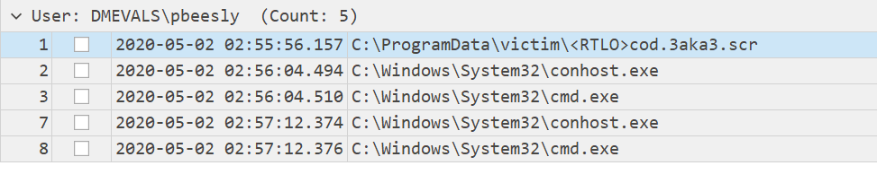
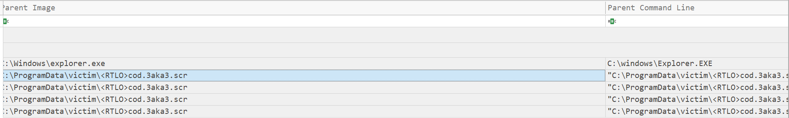

# Phase 1: Initial access

**Data used:** `STEP1_process_creation_Sysmon1.csv` (Sysmon EventID 1, process creation)

**Scenario:** A SOC alert points to suspicious activity on a user workstation. Four hosts' logs cover a 33-minute window. Reconstruct what happened.

## Q1. Which host and user account did the attacker first compromise?

**Answer: host `SCRANTON`, user `DMEVALS\pbeesly`.**

I filtered `STEP1` by host and sorted by time. The earliest suspicious process in the whole dataset is on SCRANTON, run by `pbeesly`. SCRANTON also has by far the most process-creation events (359 of 447), which supports it as the main host, but the conclusion rests on *what ran and when*, not on row counts.

## Q2. What is the first suspicious file that was executed, and what makes its name suspicious?

**Answer:** `C:\ProgramData\victim\<RTLO>cod.3aka3.scr`, started with the argument `/S`.

Three things make the file suspicious:

1. **The `<RTLO>` character.** It is a hidden Unicode character (U+202E, right-to-left override) that reverses how the following text is displayed. The name `cod.3aka3.scr` appears on screen as `rcs.3aka3.doc`, so a user sees what looks like a Word document, while Windows runs a `.scr` file.
2. **The `.scr` extension.** A screensaver is an executable program, so it is an easy way to run code while looking like something else.
3. **The location.** `C:\ProgramData\victim\` is a writable folder where normal software doesn't normally live.

## Q3. Which process launched it, and what does that say about the infection?

**Answer: `C:\Windows\explorer.exe`.**

When `explorer.exe` starts a program, it usually means a person launched it, for example by double-clicking in a folder or on the desktop. No exploit and no service started it. The user was tricked into running it.

**Proven vs inferred:** the log proves the user launched the file. It does not show how the file reached the machine. Phishing (for example a zipped attachment) is a reasonable theory, but it is an inference.

The `.scr` itself started four children: `conhost.exe` and `cmd.exe` at 02:56:04, then again at 02:57:12.

## Q4. What is the file's `ProcessGuid`?

**Answer: `{47ab858c-e13c-5eac-a903-000000000400}`**

This GUID is the starting point for every later pivot.

## Open thread

A long PowerShell command decodes Base64 text, gunzips it and runs the result as a script (Base64 decode, then gunzip, then read as text, then `ScriptBlock::Create`, then `&` runs it). It ran about 25 minutes after the first infection. Decoding the inner script is planned for a later phase.
