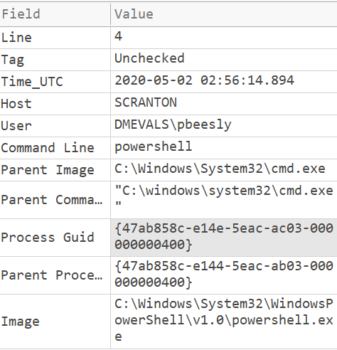
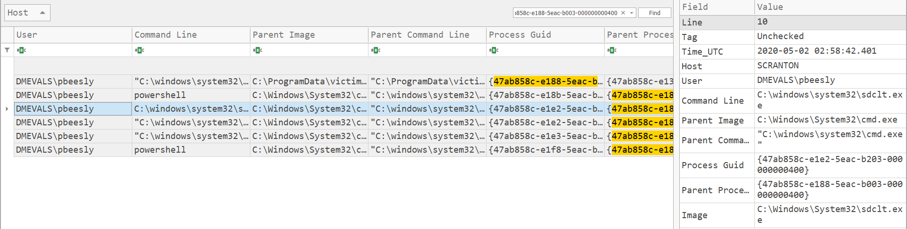

# Phase 2: Execution and tools

**Data used:** Sysmon EventID 1 (process creation), plus the other event types of the full export where noted.

## Q5. What child processes did the file create, in time order? What kind of access does this give an attacker?

Anchor: `<RTLO>cod.3aka3.scr`, `{47ab858c-e13c-5eac-a903-000000000400}`. All GUIDs below end in `-000000000400`.

| Time (UTC) | Process | ProcessGuid (prefix `47ab858c-`) | Parent |
|---|---|---|---|
| 02:56:04.494 | `conhost.exe` | `e144-5eac-aa03` | `.scr` |
| 02:56:04.510 | `cmd.exe` (session 1) | `e144-5eac-ab03` | `.scr` |
| 02:56:14.894 | `powershell.exe` (`powershell`) | `e14e-5eac-ac03` | cmd session 1 |
| 02:57:12.374 | `conhost.exe` | `e188-5eac-af03` | `.scr` |
| 02:57:12.376 | `cmd.exe` (session 2) | `e188-5eac-b003` | `.scr` |
| 02:57:15.946 | `powershell.exe` (`powershell`) | `e18b-5eac-b103` | cmd session 2 |
| 02:58:42.401 | `sdclt.exe` | `e1e2-5eac-b203` | cmd session 2 |
| 02:58:42.855 | `sdclt.exe` | `e1e2-5eac-b303` | cmd session 2 |
| 02:58:43.008 | `sdclt.exe` | `e1e3-5eac-b503` | cmd session 2 |
| 02:59:04.124 | `powershell.exe` (`powershell`) | `e1f8-5eac-bc03` | cmd session 2 |

**Observations**

- A screensaver has no reason to open a command prompt, so the chain `explorer.exe` → `.scr` → `cmd.exe` → `powershell.exe` is abnormal. Two `cmd.exe` sessions about 68 seconds apart means the attacker returned to the same foothold.
- **Session 2 does the real work.** Session 1 has one child (a plain `powershell`). Session 2 has five.
- `powershell` with no arguments is harmless alone. Its meaning comes from its parent chain. It looks like hands-on-keyboard activity: someone opened a shell and is typing commands.
- "No child processes" does not mean "no activity". A process can create files or make network connections without starting anything, so other event types are checked for the same `ProcessGuid`.

**Access gained:** an interactive **command shell** that runs commands as `DMEVALS\pbeesly` on SCRANTON. The user ran the `.scr`, and the attacker got the shell afterwards.

## Q6. Which process runs `sdclt.exe`, what is it trying to achieve, and which later process shows it worked?

The parent is the **second `cmd.exe`** (`{47ab858c-e188-5eac-b003-000000000400}`). It started **three** `sdclt.exe` processes. `sdclt.exe` is the Windows Backup and Restore program and is an **auto-elevating** binary: Windows runs it with higher rights without a UAC prompt, which is why it is abused to bypass UAC.

| Process (prefix `47ab858c-`) | Start (UTC) | IntegrityLevel | Own events |
|---|---|---|---|
| `e1e2-5eac-b203` | 02:58:42.401 | Medium | 4 |
| `e1e2-5eac-b303` | 02:58:42.855 | Medium | 4 |
| `e1e3-5eac-b503` | 02:58:43.008 | **High** | 79 |

The two Medium processes end within milliseconds (Sysmon 5). The third has High integrity and does real work, so it is the one that shows the escalation worked.

**The setup (registry hijack).** `sdclt.exe` looks for a per-user `Folder\shell\open\command` registry entry before it runs. Sysmon 13 shows PowerShell writing it twice (02:58:18 and 02:58:30) under `HKU\<SID>_Classes\Folder\shell\open\command`: the default value is the `monkey.png` PowerShell command line, and a `DelegateExecute` value is added. The auto-elevated `sdclt.exe` starts `control.exe`, which reads that per-user entry and runs the command with the elevated token. The script block `Remove-Item HKCU:\Software\Classes\Folder* -Recurse -Force` removes the hijack at 02:59:15.

**The proof the escalation worked** (Security 4688 for the resulting PowerShell):

- `Creator Process Name`: `control.exe` (a child of the High `sdclt.exe`).
- `Token Elevation Type`: `%%1937`, which is Type 2, a full elevated token.
- `Mandatory Label`: `S-1-16-12288`, which is High integrity.
- `consent.exe` (the UAC component, started by `svchost.exe`) runs at 02:58:42.868, between the second and third `sdclt.exe`. The third one starts about 140 ms later, which is too fast for a person to have answered a prompt: the elevation happened without user interaction.

Chain: `cmd.exe` → `sdclt.exe` (b503, High) → `control.exe` (b603, High) → `powershell.exe` (b803, High).

## Q7. Which PowerShell command line is long and references an image? Why hide code there?

The image is `monkey.png`, in `C:\Users\pbeesly\Downloads\`. Sysmon 11 shows the `.scr` creating it at 02:57:00.

- **Parent of the PowerShell:** `control.exe` `{47ab858c-e1e3-5eac-b603-000000000400}`.
- **The PowerShell itself:** `{47ab858c-e1e4-5eac-b803-000000000400}`, High integrity. Use this GUID in network searches (Phase 3). It has four children: `conhost.exe` (b903), `csc.exe` (ba03, 02:58:45), `powershell.exe` (c603, 03:00:13) and `powershell.exe` (d803, 03:05:24).

### What the command does, step by step

1. `sal a New-Object` makes `a` a short alias for `New-Object` (obfuscation).
2. `a System.Drawing.Bitmap('...monkey.png')` opens the picture, and `a Byte[] 4480` creates an empty buffer.
3. The loops read **the first 7 rows**, **640 pixels each**: 7 × 640 = 4,480 pixels, one byte per pixel. The rest of the image is not used.
4. For each pixel the byte is `(Blue & 0x0F) << 4 | (Green & 0x0F)`: the **lowest 4 bits** of the blue and green values are joined into one byte. Changing only the lowest bits shifts a colour by at most 15 steps out of 255, which is invisible to the eye, so the picture still looks normal.
5. `$o[0..3932]` takes the first 3,933 bytes (about 3.9 KB), converts them to text and passes them to `IEX` (`Invoke-Expression`), which runs the text as PowerShell.

### What the hidden script does

The 4104 script block at 02:58:45 (3,911 characters) shows it:

- Uses `Add-Type` with a C# definition that imports `VirtualAlloc` and `CreateThread` from `kernel32.dll`. Compiling that C# is why `csc.exe` (the C# compiler) appears as a child at 02:58:45.
- Holds a byte array of x64 machine code (shellcode), allocates executable memory, copies the code into it and runs it as a new thread.
- In the same second the PowerShell connects to `192.168.0.5:443` (Sysmon 3, 02:58:45.688).

At 03:08:51, PowerShell deletes `monkey.png` (Sysmon 23).

**Why hide code in an image:** the PNG is not an executable and does not look like a script, so file scanning and a quick look in Downloads see a picture. The code never exists as a `.ps1` on disk. The PNG is only the carrier. The command line is what unpacks and runs it, and that command line is itself the best detection point (`GetPixel`, `IEX`, a hidden window and `-ep bypass`).

## Open items from Q5, closed

- **Why two `cmd.exe` sessions 68 seconds apart?** Two separate interactive sessions started from the same implant. Session 1 produced one PowerShell and one file (`Draft.Zip`, 02:56:18). Session 2 started the privilege escalation. The detail that each session has its own `ProcessGuid` rules out a single restarted session.
- **What did the PowerShell at 02:56:14 do?** Its command line is just `powershell`, harmless alone. The same `ProcessGuid` created `C:\Users\pbeesly\AppData\Roaming\Draft.Zip` at 02:56:18 (Sysmon 11), which `sdelete` removes at 03:03:14.
