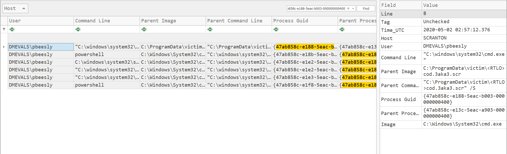
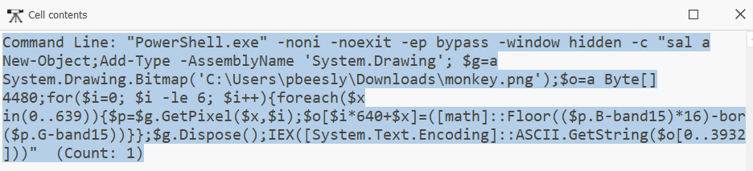

# Phase 2: Execution and tools

**Data used:** `STEP1_process_creation_Sysmon1.csv`, plus the full export where noted.

## Q5. What child processes did the file create, in time order? What kind of access does this give an attacker?

Anchor: `<RTLO>cod.3aka3.scr`, `{47ab858c-e13c-5eac-a903-000000000400}`. All GUIDs below end in `-000000000400`.

| Time (UTC) | Process | ProcessGuid (prefix `47ab858c-`) | Parent |
|---|---|---|---|
| 02:56:04.494 | `conhost.exe` | `e144-5eac-aa03` | `.scr` |
| 02:56:04.510 | `cmd.exe` (session 1) | `e144-5eac-ab03` | `.scr` |
| 02:56:14.894 | `powershell.exe` (`powershell`) | `e14e-5eac-ac03` | cmd session 1 |
| 02:57:12.374 | `conhost.exe` | `e188-5eac-af03` | `.scr` |
| 02:57:12.376 | `cmd.exe` (session 2) | `e188-5eac-b003` | `.scr` |
| 02:57:15.946 | `powershell.exe` (`powershell`) | `e18b-5eac-b103` | cmd session 2 |
| 02:58:42.401 | `sdclt.exe` | `e1e2-5eac-b203` | cmd session 2 |
| 02:58:42.855 | `sdclt.exe` | `e1e2-5eac-b303` | cmd session 2 |
| 02:58:43.008 | `sdclt.exe` | `e1e3-5eac-b503` | cmd session 2 |
| 02:59:04.124 | `powershell.exe` (`powershell`) | `e1f8-5eac-bc03` | cmd session 2 |

**Observations**

- A screensaver has no reason to open a command prompt, so the chain `explorer.exe` → `.scr` → `cmd.exe` → `powershell.exe` is abnormal. Two `cmd.exe` sessions about 68 seconds apart means the attacker returned to the same foothold.
- **Session 2 does the real work.** Session 1 has one child (a plain `powershell`). Session 2 has five.
- `powershell` with no arguments is harmless alone. Its meaning comes from its parent chain. It looks like hands-on-keyboard activity: someone opened a shell and is typing commands.
- "No child processes" does not mean "no activity". A process can create files or make network connections without starting anything, so other event types are checked for the same `ProcessGuid`.

**Access gained:** an interactive **command shell** that runs commands as `DMEVALS\pbeesly` on SCRANTON. The user ran the `.scr`, and the attacker got the shell afterwards.

## Q6. Which process runs `sdclt.exe`, what is it trying to achieve, and which later process shows it worked?

- The parent is the **second `cmd.exe`** (`{47ab858c-e188-5eac-b003-000000000400}`). It started **three** `sdclt.exe` processes: `{...-e1e2-5eac-b203-...}`, `{...-e1e2-5eac-b303-...}` and `{...-e1e3-5eac-b503-...}`.
- `sdclt.exe` is the Windows Backup and Restore program. It is an **auto-elevating** Windows binary, which is why attackers abuse it to gain higher privileges without a UAC prompt.

Open items:

- Compare the `IntegrityLevel` column of the three `sdclt.exe` processes in the full export (it is not in `STEP1`).
- Follow the processes below the last `sdclt.exe` and identify the one that shows the escalation worked.

## Q7. Which PowerShell command line is long and references an image? Why hide code there?

The image is `monkey.png`, in `C:\Users\pbeesly\Downloads\`.

Reading the command line:

- `-noni -noexit -ep bypass -window hidden` starts PowerShell without a profile, keeps it open, ignores the execution policy and hides the window. It still runs as the same user (`pbeesly`), not as SYSTEM.
- `GetPixel` reads the colour value of pixels in the image, and a loop rebuilds bytes from those colours.
- `IEX(...)` runs the rebuilt text as PowerShell code.

This technique is called **steganography**: hiding data inside an ordinary-looking file. It helps the attacker because the PNG is not an executable and may pass file-based scanning, and because an analyst skimming a Downloads folder sees a picture.

Open item: find the **parent** of this PowerShell process and connect it to the end of the `sdclt.exe` chain in Q6.
