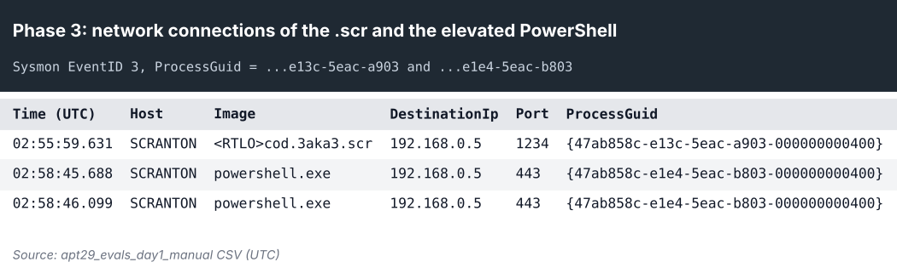
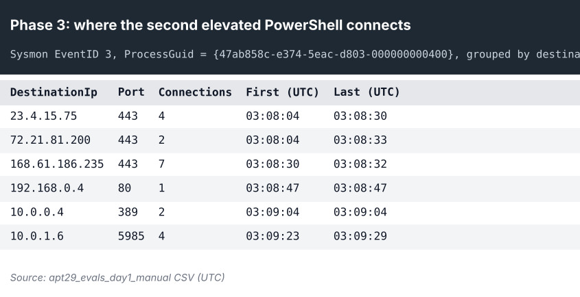
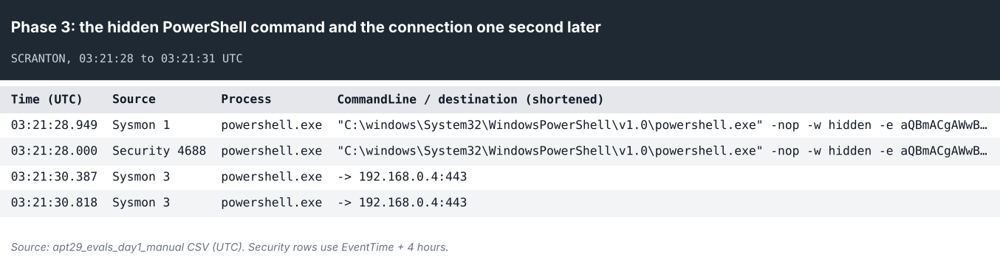
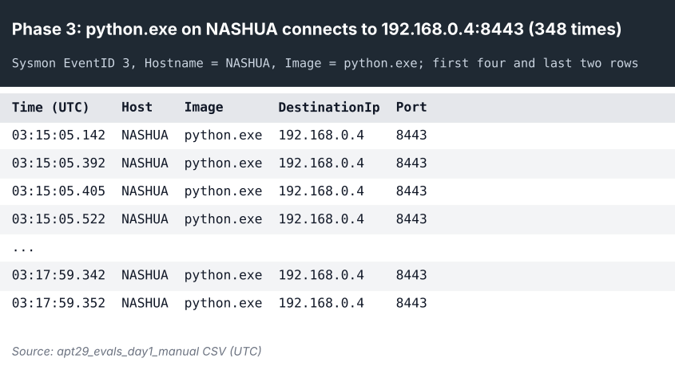

# Phase 3: Command and control

**Data used:** the full export, filtered to Sysmon 3 (network connection, 1,229 rows) and EventID 4104 (PowerShell script block).

**The rule for this phase:** filter on `ProcessGuid` first. Grouping all network rows by destination shows the whole environment (Kerberos, LDAP, NetBIOS, SMB) and hides the attack. Each attacker process makes only a handful of connections.

## P3-Q1. What does the `.scr` connect to?

Filter: `EventID = 3`, `ProcessGuid = {47ab858c-e13c-5eac-a903-000000000400}`.

| Time (UTC) | Process | Destination | Note |
|---|---|---|---|
| 02:55:59.631 | `<RTLO>cod.3aka3.scr` | `192.168.0.5:1234` | Two seconds after the file started |

`192.168.0.5` is a private (RFC1918) address, but it is in neither victim subnet (`10.0.0.x`, `10.0.1.x`). "Internal" is relative: this is a separate network segment, and it stands in for the attacker's infrastructure. Port 1234 is not a standard service port.

## P3-Q2. Where does the elevated PowerShell connect, and how does that differ?

Filter: `ProcessGuid = {47ab858c-e1e4-5eac-b803-000000000400}` (the PowerShell that reads `monkey.png`, High integrity). Its parent `control.exe` has no network events, so filter on the PowerShell and not on its parent.

| Time (UTC) | Process | Destination |
|---|---|---|
| 02:58:45.688 | `powershell.exe` (High) | `192.168.0.5:443` |
| 02:58:46.099 | `powershell.exe` (High) | `192.168.0.5:443` |

Same attacker address as Q1, different channel:

| | Channel 1 (Q1) | Channel 2 (Q2) |
|---|---|---|
| Process | the `.scr` file | PowerShell running shellcode in memory |
| Port | 1234 | 443 |
| Privilege | user (Medium) | administrator (High) |
| Starts | when the file runs | in the same second the hidden script is revealed (4104 at 02:58:45) |

An attacker wants a second channel once elevated because the first one belongs to a file on disk that can be found and deleted (it is, later), while the second lives in memory, runs with admin rights, and uses a port that looks like ordinary HTTPS traffic.

## P3-Q3. Network activity of the second PowerShell (around 03:08 UTC)

Filter: `EventID = 3`, `ProcessGuid = {47ab858c-e374-5eac-d803-000000000400}` (High integrity, started at 03:05:24 by the elevated PowerShell).

| Time (UTC) | Destination | Port | What the script blocks say | Verdict |
|---|---|---|---|---|
| 03:08:04 to 03:08:33 | `23.4.15.75`, `72.21.81.200`, `168.61.186.235` | 443 | `Invoke-Exfil` (script block at 03:08:02) installs the `7Zip4Powershell` module if it is missing. These connections match that download | Benign endpoints, suspicious context: normal destinations used by an attacker's script |
| 03:08:47 | `192.168.0.4` | 80 | `Invoke-Exfil` copies an archive to `\\192.168.0.4\webdav`. `rundll32` with `davclnt.dll,DavSetCookie 192.168.0.4` appears at 03:08:50 | Suspicious: exfiltration to the attacker's WebDAV server |
| 03:09:04 | `10.0.0.4` | 389 | Script block `Ad-Search Computer Name *` at 03:09:04 | Suspicious: Active Directory discovery over LDAP |
| 03:09:23 to 03:09:29 | `10.0.1.6` | 5985 | `Invoke-Command` to NASHUA running `Get-Process -IncludeUserName` | Suspicious: remote PowerShell (WinRM) to the next target |

The three external IPs would look harmless in a firewall log. The script blocks in the same minute are what show their purpose, which is why every network connection is paired with the 4104 events around it.

## P3-Q4. The connection at 03:21:30

| Time (UTC) | Event | Detail |
|---|---|---|
| 03:21:28.949 | Sysmon 1 | `powershell.exe -nop -w hidden -e <Base64>` |
| 03:21:29 | Security 4688 and 4104 | the same command, and the decoded script block |
| 03:21:30.387 | Sysmon 3 | PowerShell connects to `192.168.0.4:443` (and again at 03:21:30.818) |

Decoding: the Base64 text is UTF-16 PowerShell. It contains a second Base64 + gzip layer. The final script is a **shellcode loader**: `VirtualAlloc` with execute permission, `Marshal.Copy`, `CreateThread`, `WaitForSingleObject`. An embedded 614-byte x64 stager uses the Windows internet library (`wininet`) to call back to `192.168.0.4`.

The timing lines up within one second. The port (443) comes from the Sysmon 3 row, not from the shellcode text. This connection is made after the reboot (the process GUIDs now end in `-000000000500`, the next boot session), which is why Phase 4 explains how the attacker got code running again.

## A third channel, on NASHUA (found while pivoting from Phase 5)

Filter: `EventID = 3`, `Hostname = NASHUA`, `Image` ends with `python.exe`.

| Time (UTC) | Process | Destination | Count |
|---|---|---|---|
| 03:15:05 to 03:17:59 | `C:\Windows\Temp\python.exe` | `192.168.0.4:8443` | 348 connections, about one per second |

The `python.exe` that PsExec starts on NASHUA calls back to the attacker's server on a new port (8443) in a steady rhythm. That regular pattern is called **beaconing**: the implant checks in for commands, and the PowerShell, `Rar.exe` and `sdelete64` activity on NASHUA happens during the same window. The only other external connection from NASHUA in that window is a Windows `backgroundTaskHost.exe` on port 443 (03:17:12).

## Summary: every attacker connection

| Time (UTC) | Host | Process | Destination | Verdict |
|---|---|---|---|---|
| 02:55:59 | SCRANTON | `.scr` | `192.168.0.5:1234` | C2, suspicious |
| 02:58:45 | SCRANTON | PowerShell (High) | `192.168.0.5:443` | C2, suspicious |
| 03:08:04 to 03:08:33 | SCRANTON | PowerShell | three external IPs on 443 | Module download, benign endpoints in a malicious script |
| 03:08:47 | SCRANTON | PowerShell | `192.168.0.4:80` | Exfiltration over WebDAV |
| 03:09:04 | SCRANTON | PowerShell | `10.0.0.4:389` | AD discovery (LDAP) |
| 03:09:23 | SCRANTON | PowerShell | `10.0.1.6:5985` | WinRM to NASHUA |
| 03:15:05 to 03:17:59 | NASHUA | `python.exe` | `192.168.0.4:8443` | C2 beacon (348 connections) |
| 03:21:30 | SCRANTON | PowerShell | `192.168.0.4:443` | C2 re-established after reboot |
