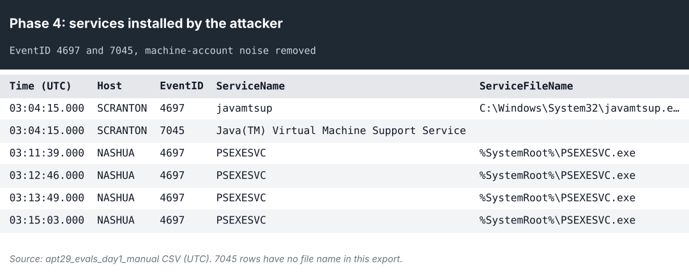
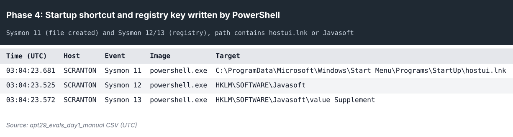
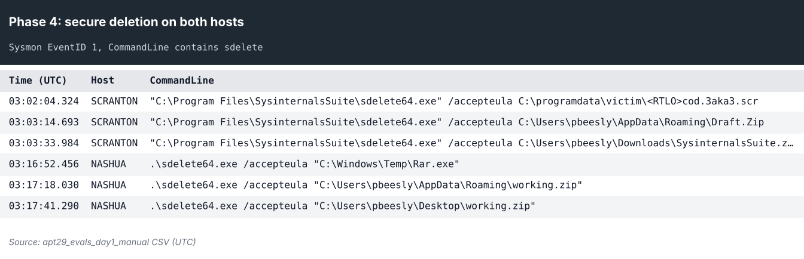
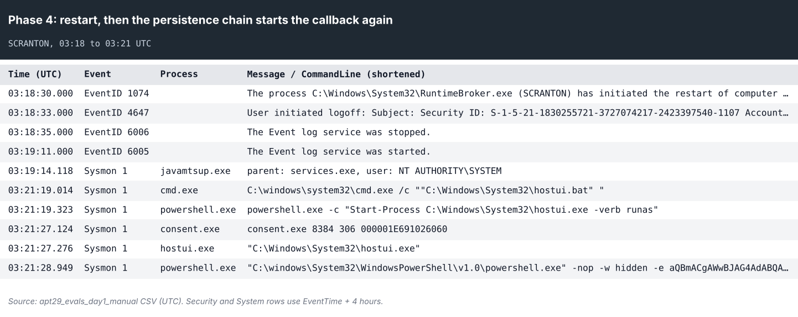

# Phase 4: Persistence and cleanup

**Data used:** the full export (EventID 4697, 7045, Sysmon 1, 11, 12, 13, 23, and the System log events 1074, 4647, 6005, 6006).

## P4-Q1. The service

Filter: `Hostname = SCRANTON`, `EventID` in (4697, 7045), then remove the `SCRANTON$` machine-account rows.

| Time (UTC) | Event | Service name | Binary | Account |
|---|---|---|---|---|
| 03:04:15 | 4697 and 7045 | `javamtsup` ("Java(TM) Virtual Machine Support Service") | `C:\Windows\System32\javamtsup.exe` | LocalSystem, start type 2 (automatic) |

- **Why the name misleads:** it imitates a Java support service in `System32`, so it looks like routine software. The file was part of the archive the attacker unpacked at 03:00:32 (`Downloads\SysinternalsSuite\javamtsup.exe`).
- **First run:** 03:19:14, **after the reboot**. `javamtsup.exe` is started by `services.exe` as `NT AUTHORITY\SYSTEM` (System integrity). It then starts an `rundll32.exe` with no arguments at 03:19:14.525, a pattern detection rules flag as a "sacrificial process". I did not trace it further in this window.

## P4-Q2. Other persistence

| Type | Filter | Result |
|---|---|---|
| Service | 4697, 7045 | **Present**: `javamtsup` |
| Startup folder | Sysmon 11, path contains `Startup` | **Present**: `C:\ProgramData\Microsoft\Windows\Start Menu\Programs\StartUp\hostui.lnk`, written by PowerShell at 03:04:23 |
| Registry-stored payload | Sysmon 12 and 13, path contains `Javasoft` | **Present**: key `HKLM\SOFTWARE\Javasoft`, value `value Supplement`, created by PowerShell at 03:04:23 |
| Scheduled task | 4698 | Not present |
| WMI subscription | Sysmon 19, 20, 21 | Not present |
| Log clearing | 1102, 104 | Not present |

What the gaps tell you: this attacker used three methods that blend in (a service with a Java name, a startup shortcut, and a payload stored in the registry) and did not try to wipe the event logs. The Security log is therefore reliable for this case.

**The startup chain, proven after the reboot (03:21 UTC):**

| Time (UTC) | Process | Command line | Parent |
|---|---|---|---|
| 03:21:19.014 | `cmd.exe` (Medium) | `cmd /c ""C:\Windows\System32\hostui.bat" "` | `explorer.exe` |
| 03:21:19.323 | `powershell.exe` | `Start-Process C:\Windows\System32\hostui.exe -verb runas` | `cmd.exe` |
| 03:21:27.124 | `consent.exe` | the UAC prompt | `svchost.exe` |
| 03:21:27.276 | `hostui.exe` (**High**) | `"C:\Windows\System32\hostui.exe"` | `powershell.exe` |
| 03:21:27.859 | `powershell.exe` (Medium) | reads `HKLM:\SOFTWARE\Javasoft` `value Supplement` and executes it | `hostui.exe` |
| 03:21:28.949 | `powershell.exe` | `-nop -w hidden -e <Base64>` (the shellcode loader from Phase 3, Q4) | `powershell.exe` |

`explorer.exe` starting `hostui.bat` right after the user logs back on matches the Startup folder entry. I did not see the shortcut's target in the logs, so that link is inferred. The registry value is read by PowerShell and runs the stager that calls back to `192.168.0.4:443`. The malicious code is never stored as a file on disk.

## P4-Q3. Secure deletion

Filter: Sysmon 1, `CommandLine` contains `sdelete`.

| Time (UTC) | Host | Target |
|---|---|---|
| 03:02:04 | SCRANTON | the original `.scr` in `C:\ProgramData\victim\` |
| 03:03:14 | SCRANTON | `AppData\Roaming\Draft.Zip` |
| 03:03:33 | SCRANTON | `Downloads\SysinternalsSuite.zip` |
| 03:16:52 | NASHUA | `C:\Windows\Temp\Rar.exe` |
| 03:17:18 | NASHUA | `AppData\Roaming\working.zip` |
| 03:17:41 | NASHUA | `Desktop\working.zip` |

Pattern: the attacker removes the **delivery file**, the **staging archives** and the **tools**. The persistence items are left in place. Other cleanup in the logs:

- `monkey.png` was deleted by PowerShell at 03:08:51 (Sysmon 23), just after the connection to the exfiltration server.
- `Invoke-BeachCleanup` (script block at 03:08:51) removes the certificate, screenshot and archive files.
- The registry hijack used for the UAC bypass was deleted at 02:59:15 (`Remove-Item HKCU:\Software\Classes\Folder* -Recurse -Force`).

**The `Draft.Zip` question from Phase 2:** the PowerShell started by the first `cmd.exe` session (02:56:14) created `C:\Users\pbeesly\AppData\Roaming\Draft.Zip` at 02:56:18. It was wiped with `sdelete` at 03:03:14.

## P4-Q4. The reboot

| Time (UTC) | Event | Detail |
|---|---|---|
| 03:18:30 | System 1074 | restart initiated by `RuntimeBroker.exe` on behalf of `DMEVALS\pbeesly` |
| 03:18:33 | Security 4647 | user-initiated logoff |
| 03:18:35 | System 6006 | event log service stopped |
| 03:19:11 | System 6005 | event log service started |
| 03:19:14 | Sysmon 1 | `javamtsup.exe` starts as SYSTEM |

A restart is not log clearing: the logs continue on both sides of it, and no 1102 or 104 event exists. The service came back by itself, and the logon at 03:21 re-triggered the startup chain above.
