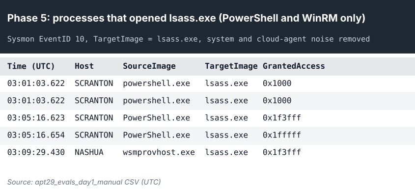
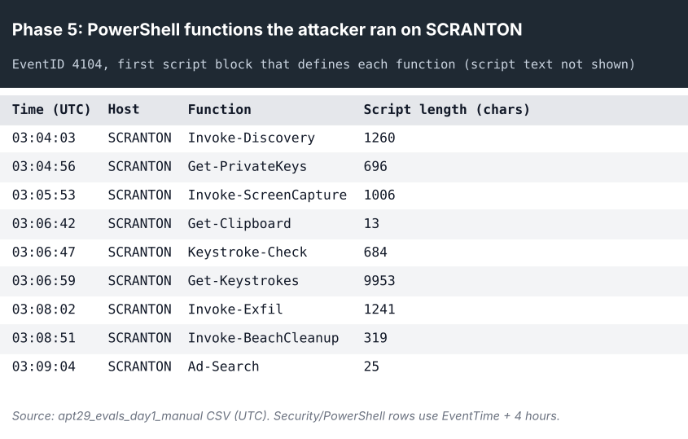
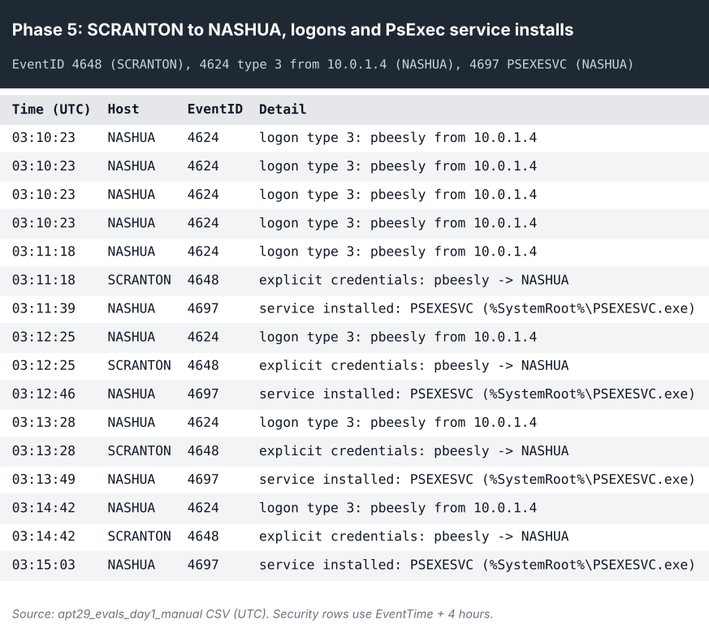
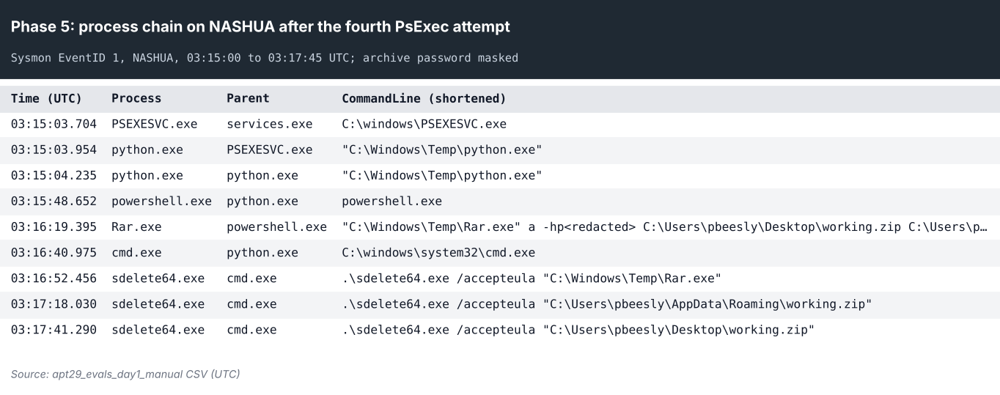

# Phase 5: Credentials and lateral movement

**Data used:** the full export (Sysmon 1, 3, 10, 11, Security 4624, 4648, 4697, 7045 and EventID 4104).

## P5-Q1. LSASS access

Filter: Sysmon 10, `TargetImage` ends with `lsass.exe`, then group by `SourceImage`.

| Time (UTC) | Host | Source process | GrantedAccess | Verdict |
|---|---|---|---|---|
| 03:05:16 | SCRANTON | `powershell.exe` (the elevated one) | `0x1f3fff`, then `0x1fffff` | **Abnormal**: full access to the credential store, within a second of each other |
| 03:09:29 | NASHUA | `wsmprovhost.exe` | `0x1f3fff` | Likely a side effect of the remote `Get-Process -IncludeUserName` from 03:09:23; needs the remote session context to confirm |
| 03:01:03 | SCRANTON | `powershell.exe` | `0x1000` | Limited query right, not a memory read |
| 03:19 to 03:20 | SCRANTON | Azure agents, `svchost`, `wininit`, `csrss` | `0x1000`, `0x1400`, `0x1fffff` at boot | Normal noise |



`0x1fffff` is "all access" and `0x1f3fff` includes read and write of memory. A PowerShell process asking for either on `lsass.exe` is the credential-dumping signature. The logs show the **access**, but not a memory dump file, so "credential dumping attempted" is the proven claim and "credentials stolen" is an inference.

## P5-Q2. What the attacker ran on SCRANTON (03:04 to 03:09)

Filter: `EventID = 4104`, `Hostname = SCRANTON`. Script block text is HTML-escaped in this export (`&lt;`).

| Time (UTC) | Function | What it does | ATT&CK |
|---|---|---|---|
| 03:04:03 | `Invoke-Discovery` | Collects information about the host and user | T1082, T1033 |
| 03:04:56 | `Get-PrivateKeys` | Exports certificates and private keys | T1552.004 |
| 03:05:53 | `Invoke-ScreenCapture` | Takes screenshots (`CopyFromScreen`) | T1113 |
| 03:06:42 | `Get-Clipboard` | Reads the clipboard | T1115 |
| 03:06:47 to 03:06:59 | `Keystroke-Check` and `Get-Keystrokes` | Checks for security products, then logs key presses and the active window | T1056.001 |
| 03:08:02 | `Invoke-Exfil` | Packs the Downloads folder into `AppData\Roaming\OfficeSupplies.7z`, copies it to `\\192.168.0.4\webdav` | T1560.001, T1048.003 |
| 03:08:51 | `Invoke-BeachCleanup` | Deletes the collected files | T1070.004 |
| 03:09:04 | `Ad-Search Computer Name *` | Searches Active Directory for computer objects | T1018 |



## P5-Q3. Where the data went

| Time (UTC) | Evidence |
|---|---|
| 03:08:35 | Sysmon 11: PowerShell creates `OfficeSupplies.7z` |
| 03:08:47 | Sysmon 3: PowerShell connects to `192.168.0.4:80` |
| 03:08:50 | `rundll32 davclnt.dll,DavSetCookie 192.168.0.4 http://192.168.0.4/webdav`, started by `svchost.exe` (the WebDAV client) |
| 03:08:51 | Archive and other staged files deleted |

The data left over **WebDAV (HTTP, port 80)** to the same `192.168.0.4` that later receives the 443 callback. WebDAV is unencrypted here, so a network sensor would also see it.

## P5-Q4. Lateral movement from SCRANTON to NASHUA

| Time (UTC) | Host | Event | Detail |
|---|---|---|---|
| 03:09:23 | SCRANTON | Sysmon 3 | WinRM to `10.0.1.6:5985` (discovery of NASHUA first, with `Invoke-Command`) |
| 03:10:23 | NASHUA | 4624, logon type 3 | `pbeesly` from `10.0.1.4` (SCRANTON). Network logon, using the stolen or existing credentials |
| 03:10:23 | NASHUA | Sysmon 11 | `C:\Windows\Temp\python.exe` is written by the `System` process (consistent with a copy over SMB) |
| 03:11:18, 03:12:25, 03:13:28, 03:14:42 | SCRANTON | 4648 | Four **explicit-credential** logon attempts, target `NASHUA`, account `pbeesly` |
| 03:11:39, 03:12:46, 03:13:49, 03:15:03 | NASHUA | 4697 and 7045 | Service `PSEXESVC` (`%SystemRoot%\PSEXESVC.exe`) installed, each time followed by `python.exe` |
| 03:14:25 | NASHUA | Sysmon 1 | `consent.exe` (a UAC prompt) before the fourth attempt |
| 03:15:04 | NASHUA | Sysmon 1 | `python.exe` starts a child `python.exe`, and the chain continues |



Reading it: `PsExec` (the `PSEXESVC` service) was used four times. The first three attempts start `python.exe` only once, then nothing follows. The fourth passes a UAC consent step and the process chain continues, so attempts 1 to 3 are best read as failed or incomplete. The `python.exe` is probably not a normal Python install: it runs from `C:\Windows\Temp` and extracts into `AppData\Local\Temp\_MEI29522` (Sysmon 11 at 03:15:04), which is how a PyInstaller-packed program behaves.

## P5-Q5. What the attacker did on NASHUA (03:15 to 03:18)

Process tree from the fourth `PSEXESVC` service:

```
services.exe
└─ PSEXESVC.exe                         03:15:03.704
   └─ python.exe                        03:15:03.954   (C:\Windows\Temp)
      └─ python.exe                     03:15:04.235
         ├─ powershell.exe              03:15:48.652
         │  └─ Rar.exe                  03:16:19.395   a -hp<password> Desktop\working.zip AppData\Roaming\working.zip
         └─ cmd.exe                     03:16:40.975
            ├─ sdelete64.exe            03:16:52  Rar.exe
            ├─ sdelete64.exe            03:17:18  AppData\Roaming\working.zip
            └─ sdelete64.exe            03:17:41  Desktop\working.zip
```



- `python.exe` writes `C:\Windows\Temp\Rar.exe` at 03:15:31 and PowerShell creates `AppData\Roaming\working.zip` at 03:16:00.
- `Rar.exe a -hp...` is the command-line archiver, with the `-hp` option, which encrypts the contents and the file names of the archive with a password. This is staging for exfiltration. The password is not reproduced in this write-up.
- The cleanup mirrors SCRANTON: archives and the tool are wiped with `sdelete64`.
- **The implant beacons.** From 03:15:05 to 03:17:59 `python.exe` makes 348 connections to `192.168.0.4:8443` (Sysmon 3), roughly one a second. Apart from one Windows `backgroundTaskHost.exe` connection on port 443, it is the only external connection from NASHUA in the window, so it is the command channel and the likeliest route out for the archive. Sysmon 3 does not record how many bytes were sent, so the exfiltration of `working.zip` is **not proven**.

## P5-Q6. What the earlier discovery says about intent

The LDAP search (`10.0.0.4:389`) lists the computers in the domain, and the WinRM command (`Get-Process -IncludeUserName` on NASHUA) shows which accounts are logged on there. Together they answer "where else can I go, and who is on that machine". The attacker then chose NASHUA.
