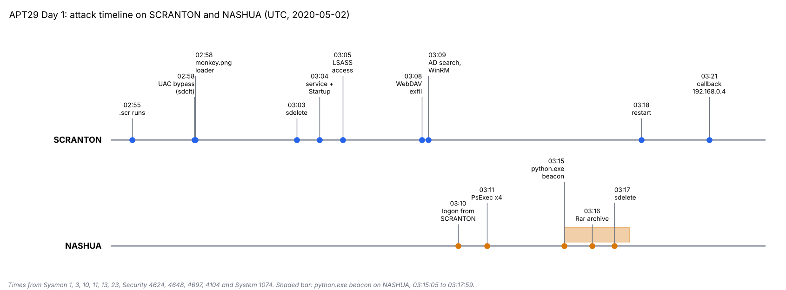

# Attack timeline and MITRE ATT&CK map

All times are UTC on 2020-05-02. Sysmon rows use `UtcTime`. Security and PowerShell rows only have local time, so the table uses `EventTime + 4 hours`. "Proven" means a log row shows it. "Inferred" means a reasonable reading that no single row proves.

## Summary in five lines

1. **Entry:** user `pbeesly` on SCRANTON double-clicked a screensaver file disguised as a document (`<RTLO>cod.3aka3.scr`).
2. **Privilege:** a UAC bypass through `sdclt.exe` gave the attacker an administrator PowerShell without any prompt.
3. **Payload and C2:** shellcode hidden in the pixels of `monkey.png` called back to `192.168.0.5`. A second callback to `192.168.0.4` came after a reboot.
4. **Collection and exfiltration:** private keys, screenshots, clipboard and keystrokes were collected and the Downloads folder was sent to `192.168.0.4` over WebDAV.
5. **Spread and cleanup:** after an AD search, the attacker used PsExec to move to NASHUA, archived data with a password, kept a beaconing implant talking to `192.168.0.4:8443`, and wiped files with `sdelete` on both hosts. UTICA and NEWYORK were not touched by the attacker.

## Timeline

| Time (UTC) | Host | What happened | Evidence | ATT&CK |
|---|---|---|---|---|
| 02:55:57 | SCRANTON | `explorer.exe` runs `C:\ProgramData\victim\<RTLO>cod.3aka3.scr /S` as `pbeesly` | Sysmon 1, 4688 | T1204.002, T1036.002 |
| 02:55:59 | SCRANTON | The `.scr` connects to `192.168.0.5:1234` | Sysmon 3 | T1095 (inferred) |
| 02:56:04 | SCRANTON | First `cmd.exe` and `conhost.exe`; PowerShell at 02:56:14 | Sysmon 1 | T1059.003, T1059.001 |
| 02:56:18 | SCRANTON | PowerShell creates `AppData\Roaming\Draft.Zip` | Sysmon 11 | T1074.001 (inferred) |
| 02:57:00 | SCRANTON | `.scr` writes `Downloads\monkey.png` | Sysmon 11 | T1105, T1027.003 |
| 02:57:12 | SCRANTON | Second `cmd.exe` session; PowerShell at 02:57:15 | Sysmon 1 | T1059.003, T1059.001 |
| 02:58:18 to 02:58:30 | SCRANTON | Registry hijack `Folder\shell\open\command` and `DelegateExecute` | Sysmon 13 | T1548.002, T1112 |
| 02:58:42 to 02:58:43 | SCRANTON | Three `sdclt.exe`; the third is High integrity, then `control.exe` and a High PowerShell | Sysmon 1, 4688 (`%%1937`, High) | T1548.002 |
| 02:58:45 | SCRANTON | PowerShell reads `monkey.png`, runs the hidden shellcode loader (`csc.exe` appears) | Sysmon 1, 4104 | T1027.003, T1027.004, T1620 |
| 02:58:45 | SCRANTON | Elevated PowerShell connects to `192.168.0.5:443` | Sysmon 3 | T1071 (inferred) |
| 02:59:15 | SCRANTON | Hijack key removed | 4104 | T1112 |
| 02:59:42 to 03:00:32 | SCRANTON | `SysinternalsSuite.zip` written and unpacked, including `javamtsup.exe` | Sysmon 11 | T1105 |
| 03:02:04 to 03:03:33 | SCRANTON | `sdelete64` wipes the `.scr`, `Draft.Zip`, `SysinternalsSuite.zip` | Sysmon 1 | T1070.004 |
| 03:04:03 | SCRANTON | `Invoke-Discovery` | 4104 | T1082, T1033 |
| 03:04:15 | SCRANTON | Service `javamtsup` installed (LocalSystem, automatic) | 4697, 7045 | T1543.003 |
| 03:04:23 | SCRANTON | `hostui.lnk` in the Startup folder; registry key `HKLM\SOFTWARE\Javasoft` created | Sysmon 11, 12, 13 | T1547.001, T1112 |
| 03:04:56 | SCRANTON | `Get-PrivateKeys` | 4104 | T1552.004 |
| 03:05:16 | SCRANTON | Elevated PowerShell opens `lsass.exe` with `0x1f3fff` and `0x1fffff` | Sysmon 10 | T1003.001 (access proven, dump not) |
| 03:05:24 | SCRANTON | Second elevated PowerShell (`d803`) starts | Sysmon 1 | T1059.001 |
| 03:05:53 | SCRANTON | `Invoke-ScreenCapture` | 4104 | T1113 |
| 03:06:42 to 03:06:59 | SCRANTON | `Get-Clipboard`, `Keystroke-Check`, `Get-Keystrokes` | 4104 | T1115, T1056.001 |
| 03:08:02 to 03:08:35 | SCRANTON | `Invoke-Exfil`: module downloads, `OfficeSupplies.7z` created | 4104, Sysmon 3, 11 | T1560.001, T1105 |
| 03:08:47 to 03:08:51 | SCRANTON | Copy to `192.168.0.4` over WebDAV; `monkey.png` and staged files deleted | Sysmon 3, 1, 23, 4104 | T1048.003, T1070.004 |
| 03:09:04 | SCRANTON | LDAP search of Active Directory (`10.0.0.4:389`) | Sysmon 3, 4104 | T1018 |
| 03:09:23 to 03:09:29 | SCRANTON, NASHUA | WinRM `Invoke-Command` to `10.0.1.6`; `wsmprovhost` touches `lsass.exe` | Sysmon 3, 10 | T1021.006 |
| 03:10:23 | NASHUA | Network logon (type 3) for `pbeesly` from `10.0.1.4`; `python.exe` written to `C:\Windows\Temp` | 4624, Sysmon 11 | T1021.002, T1570 |
| 03:11:18 to 03:15:03 | SCRANTON, NASHUA | Four PsExec attempts (4648; `PSEXESVC` installed four times) | 4648, 4697, 7045 | T1569.002, T1078 |
| 03:15:04 to 03:16:19 | NASHUA | `python.exe` chain, PowerShell, `Rar.exe a -hp ...` creates `working.zip` | Sysmon 1, 11 | T1560.001 |
| 03:15:05 to 03:17:59 | NASHUA | `python.exe` beacons to `192.168.0.4:8443` (348 connections) | Sysmon 3 | T1071 (inferred) |
| 03:16:52 to 03:17:41 | NASHUA | `sdelete64` wipes `Rar.exe` and both `working.zip` copies | Sysmon 1 | T1070.004 |
| 03:18:30 to 03:19:11 | SCRANTON | Restart initiated by `pbeesly`; logoff; event log service stops and starts (not cleared) | System 1074, 6006, 6005; 4647 | n/a |
| 03:19:14 | SCRANTON | `javamtsup.exe` runs as SYSTEM and spawns `rundll32.exe` | Sysmon 1 | T1543.003 |
| 03:21:19 to 03:21:28 | SCRANTON | After logon: `hostui.bat`, `hostui.exe` (High, after `consent.exe`), registry-stored payload | Sysmon 1, 12, 13 | T1547.001, T1059.001, T1027.011 (inferred) |
| 03:21:29 to 03:21:30 | SCRANTON | Hidden Base64 PowerShell, shellcode loader, connection to `192.168.0.4:443` | 4688, 4104, Sysmon 3 | T1620, T1071 (inferred) |

The dataset ends at 03:28:17.

## Indicators (from this lab dataset)

| Type | Value |
|---|---|
| Hosts | SCRANTON (patient zero, 10.0.1.4), NASHUA (10.0.1.6, second host) |
| Account | `DMEVALS\pbeesly` |
| Attacker addresses | `192.168.0.5` (ports 1234, 443), `192.168.0.4` (ports 80, 443, 8443) |
| Files | `C:\ProgramData\victim\<RTLO>cod.3aka3.scr`, `Downloads\monkey.png`, `C:\Windows\System32\javamtsup.exe`, `C:\Windows\System32\hostui.exe`, `hostui.bat`, `hostui.lnk` (Startup), `AppData\Roaming\OfficeSupplies.7z`, `C:\Windows\Temp\python.exe`, `C:\Windows\Temp\Rar.exe`, `working.zip` |
| Service names | `javamtsup`, `PSEXESVC` |
| Registry | `HKLM\SOFTWARE\Javasoft\value Supplement`, `HKU\<SID>_Classes\Folder\shell\open\command` |
| Command-line fragments | `GetPixel` with `IEX`, `-nop -w hidden -e`, `sdelete64 /accepteula`, `Rar.exe a -hp` |

## What the logs do not show

- Whether the LSASS access produced a memory dump, and whether any credentials were used elsewhere. The 4648 logons use the same account (`pbeesly`) the user already had.
- What the empty `rundll32.exe` started by `javamtsup.exe` did afterwards.
- Whether the NASHUA `working.zip` left the network. The only attack-related external connection from NASHUA is the `python.exe` beacon to `192.168.0.4:8443`, and Sysmon 3 does not record bytes sent.
- The target of the `hostui.lnk` shortcut (the link to `hostui.bat` is inferred from the process tree).
- No attacker activity appears on UTICA or NEWYORK.

## Defender takeaways

1. Alert on `explorer.exe` starting a `.scr` from `ProgramData` and on the right-to-left override character (U+202E) in a path.
2. Alert on `sdclt.exe` (and other auto-elevating binaries) writing or reading `Folder\shell\open\command`.
3. PowerShell command lines that use `GetPixel` and `IEX`, or `-nop -w hidden -e` with a long Base64 string.
4. A service installed from an interactive user session (4697 with the user's own account) whose name imitates other software.
5. LSASS access with full rights from PowerShell.
6. `PSEXESVC` installed repeatedly on the same host in a few minutes.
7. Keep Sysmon, Security 4688 with command lines and PowerShell 4104 logging on: this entire reconstruction depends on them.
