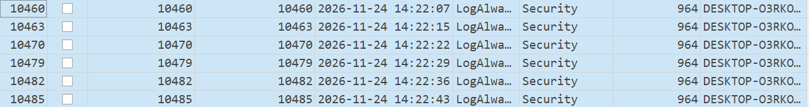
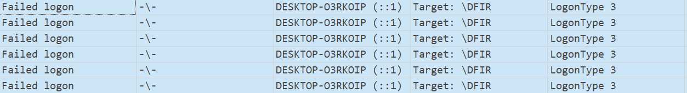
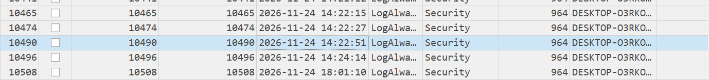
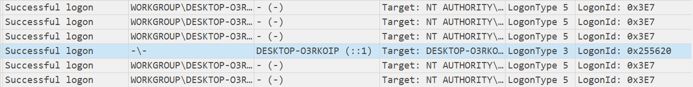
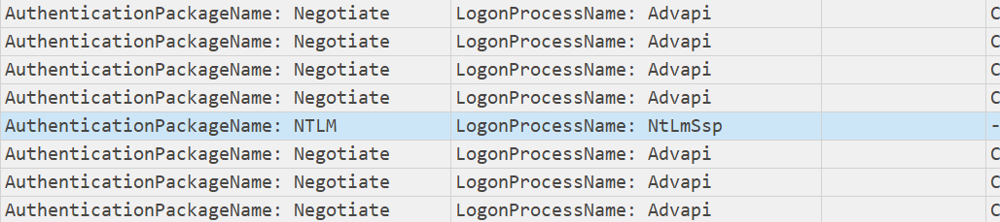
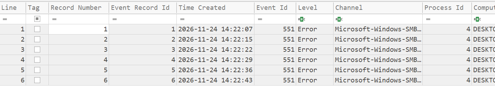
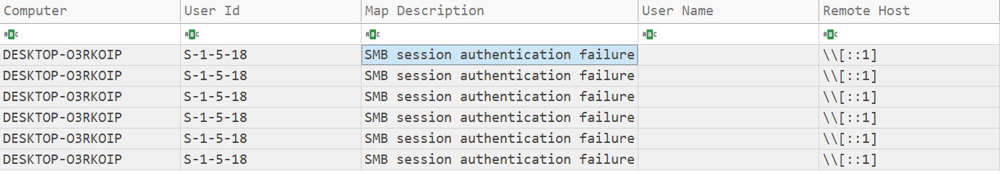

# Lab 01 — Logon brute-force

A self-built case: I generated a password-guessing pattern against my own VM,
collected the logs, and investigated it as if responding to a SOC alert.

## The alert

```
TICKET #0001  —  SIEM AUTH-BRUTEFORCE RULE
Severity:   Medium
Host:       DESKTOP-O3RKO1P (Windows 10)
Account:    DFIR
Detected:   2026-11-24  ~14:22 UTC
Trigger:    Multiple failed logons for a single account in a short window,
            followed by a successful logon from the same source.
Action:     Confirm or dismiss. Did the account get compromised?
```

## How the activity was generated

`generate.ps1` makes six failed network logons for the `DFIR` account using a
wrong password, each three seconds apart, then one logon with the correct
password. All traffic is local (`net use \\localhost\IPC$`), so every logon
arrives over the network path rather than the keyboard.

## Evidence collected

| File | Role |
|---|---|
| `Security.evtx` | Primary. Logon success (4624) and failure (4625) events. |
| `System.evtx` | Context: service and system events around the window. |
| `Microsoft-Windows-SMBServer%4Security.evtx` | The `net use` sessions arrive over SMB, so the SMB server logs them too. |

Logs were exported to CSV with EvtxECmd and reviewed in Timeline Explorer.
EvtxECmd writes timestamps in UTC, so the whole case is read in UTC.

## Findings

### Failed logons

Six `4625` events for account `DFIR`, from 14:22:07 to 14:22:43 UTC — roughly
one every six to eight seconds. The even, machine-speed spacing points to a
script rather than a person typing.



Each failure is **Logon Type 3 (network)**, with the source shown as the local
host over IPv6 (`::1`) and the target account `DFIR`.



**Failure reason.** The `4625` events carry a **Sub Status** of `0xC000006A`,
which means the username is valid but the password is wrong. (A different code
tells a different story: `0xC0000064` would mean the username itself does not
exist, and `0xC0000234` would mean the account is locked out.) A run of
`0xC000006A` against one real account is password guessing, not username
spraying.

### The successful logon

A `4624` at 14:22:51 UTC, eight seconds after the last failure — the same
account, the same network path.



The detail confirms **Logon Type 3**, source `::1`, and **Logon ID `0x255620`**.
That Logon ID is the thread that ties this session together: any activity by the
session can be followed by matching this value, and the session's end is the
logoff event (4634/4647) carrying the same ID.



The authentication package is **NTLM** (`LogonProcessName: NtLmSsp`), which
stands out from the routine `Negotiate` / `Advapi` system logons around it — a
useful way to pick the relevant logon out of the noise.



### Cross-check against the SMB server log

Because the logons came in over SMB, the SMB server logged them independently.
`Microsoft-Windows-SMBServer%4Security` shows **six Event ID 551 (Error)** rows
at the same timestamps, 14:22:07 to 14:22:43.



Each is mapped as **"SMB session authentication failure"**, from remote host
`\\[::1]`, under `S-1-5-18`. Two independent logs agreeing on the same six
failures at the same times is strong confirmation.



### Summary table

| Time (UTC) | Event ID | Source | Account | Result |
|---|---|---|---|---|
| 14:22:07 | 4625 + SMB 551 | `::1` | DFIR | Failure (wrong password) |
| 14:22:15 | 4625 + SMB 551 | `::1` | DFIR | Failure |
| 14:22:22 | 4625 + SMB 551 | `::1` | DFIR | Failure |
| 14:22:29 | 4625 + SMB 551 | `::1` | DFIR | Failure |
| 14:22:36 | 4625 + SMB 551 | `::1` | DFIR | Failure |
| 14:22:43 | 4625 + SMB 551 | `::1` | DFIR | Failure |
| 14:22:51 | 4624 | `::1` | DFIR | **Success (network, NTLM, LogonId 0x255620)** |

## Verdict

**The account was compromised.** The `4624` success at 14:22:51, immediately
following six failures for the same account over the same network path, is the
proof row. The next steps in a real case are to follow **Logon ID `0x255620`**
into whatever the session did afterward, and to use the **source address** to
identify where the attempts came from.

## What these logs do not show

- They prove a correct password was accepted. They do **not** prove a human was
  at the keyboard, only that valid credentials were presented.
- They do **not** show what the account did **after** 14:22:51 — process
  execution and file activity live in other logs (4688, Sysmon), covered in the
  next lab.
- They do **not** reveal how the password was obtained (guessed, reused, leaked).
